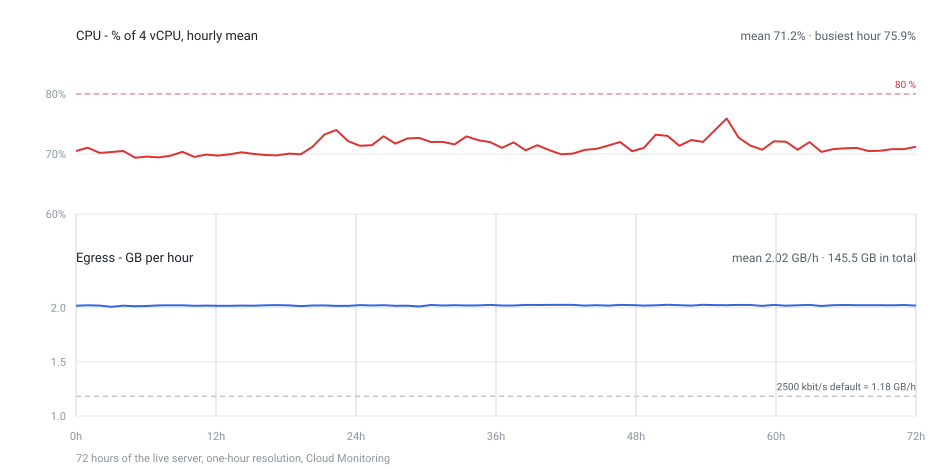
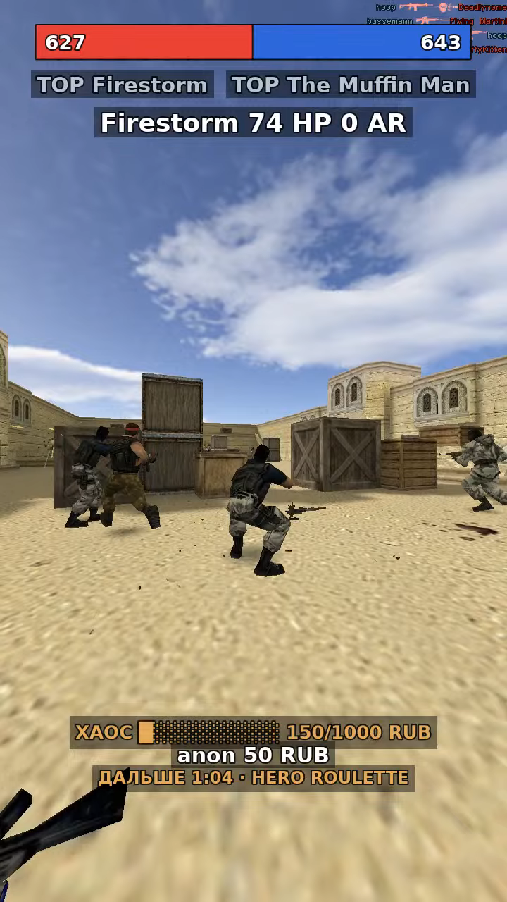
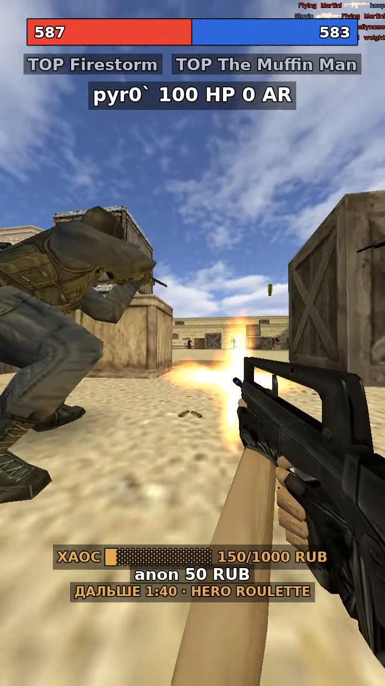

# cs16-shortchaos

**English** · [Русский](README.ru.md)

Counter-Strike 1.6 (CS 1.6) dedicated server with bots, streamed vertically to YouTube Shorts. A
viewer donation is turned into an in-game activity: knife round, zombie round, one bot with an
M249 against everyone, map change, and so on. Everything is driven by donations, nobody plays
by hand.

Status: stage 3 works end to end on a live server — the control API polls donations (mock or
DonationAlerts), maps them to activities, enforces cooldowns, sends RCON commands and stores
the verdict. Verified on ReHLDS + Metamod-R + AMX Mod X: a 50 RUB donation reached the plugin
in game (`donation_events ran bot_nick`).

## Requirements

The control API is plain Node with no runtime dependencies; the game server and the capture client
are two Docker images.

| What | Minimum | Why |
| --- | --- | --- |
| Node.js | **24** (`engines` in `package.json`) | `npm start`, `npm test` and the scripts run the `.ts` sources directly, so there is no build step and nothing to transpile |
| Docker | Engine 27+ with the compose plugin 2.30+ | the compose file uses `cpuset:` and `depends_on: condition:` |
| CPU | x86_64, 4 vCPU | the images carry 32-bit GoldSrc and Xash3D binaries; an ARM host would emulate every frame |
| RAM | 4 GB (8 GB builds comfortably) | the live stack measures ~1.1 GB, the image build wants ~2 GB |
| Disk | 40 GB (60 GB comfortable) | two images ~4 GB, the server volume ~1.5 GB, the client volume ~2 GB |
| Network | 5 Mbit up, 100 Mbit down | the upload measured 4.3 Mbit/s CBR on the live host, so 5 Mbit up is a floor, not a comfort |
| GPU, display | none on the `x11`/Docker path | the capture client renders on its own Xvfb with software OpenGL; `STREAM_SOURCE=desktop` grabs a real desktop session instead |
| Ports | loopback only: 27015, 8080 (panel), 8888/8889 (local view), 4318 (OAuth callback) | nothing listens on a public interface |

`npm install` fetches two dev dependencies (TypeScript and `@types/node`) and only
`npm run typecheck` needs them: `npm start` runs the sources as they are.

Three days of the live server, from Cloud Monitoring (`docs/deploy.md`, "What the live server used
over three days"): CPU averaged 71 % of 4 vCPU, the upload was a flat 4.5 Mbit/s — 48 GB a day,
~1.45 TB a month — and the VM was never restarted. No dates on the axis; the shape is the point.



## Install and build

A fresh clone is complete — the maps, the navigation graphs the bots read and the hero models are
committed, so nothing is downloaded from a map site and there is no fetch step to remember.

```bash
git clone https://github.com/silentalarm/cs16-shortchaos.git
cd cs16-shortchaos
npm install                              # dev only: TypeScript for `npm run typecheck`
cp .env.example .env && chmod 600 .env   # RCON_PASSWORD and ADMIN_TOKEN; the rest may stay empty
```

**One file is not in git and the build refuses to start without it:** `infra/checksums.env`, the
pinned URL and SHA256 of every component (HLDS app 90, ReHLDS, ReGameDLL, Metamod-R, AMX Mod X,
YaPB, Xash3D, CS16Client). Resolve it once on a machine with PowerShell and copy it over; keep it
LF-clean, because `infra/build-images.sh` strips a stray `\r` for exactly this reason.

```bash
pwsh -File infra/update-checksums.ps1    # writes infra/checksums.env; PowerShell, there is no bash twin
bash infra/build-images.sh               # both images, 10-20 min on 4 vCPU
bash infra/build-images.sh hlds          # game server only: the usual case for a plugin or config change
```

Every download is verified against its pinned SHA256 during the build; `infra/verify-image.ps1` is
the supply-chain gate after it (binary whitelist, no suid, trivy HIGH/CRITICAL).

Then the stack. `dev` is the mode to start with: the game server and the panel, capture client
stopped, so no stream key is needed yet.

```bash
bash infra/compose.sh dev                # hlds + control-api, capture client stopped
bash infra/compose.sh logs -f hlds       # wait for "donation_events loaded"
```

`bash infra/compose.sh up -d` (no `dev`) brings the capture container as well, and that one needs
`YOUTUBE_STREAM_KEY` or `STREAM_OUTPUT`. The wrapper passes `--env-file .env` from the repository root
explicitly: compose would otherwise look for it next to `infra/docker-compose.yml` and fail with
`required variable RCON_PASSWORD is missing a value`.

Three checks that need no donation, no live channel and no game server:

```bash
npm run ui-preview                       # the panel, rendered locally
RCON_PASSWORD= npm start                 # dry run: commands are logged, never sent
npm test                                 # node:test, including the .env.example secret guard
```

With the stack up, the control API logs `plugin.contract_ok` when `amx_de codes` matches
`config/activities.json` — that line is the contract between the catalogue and the compiled plugin.

On a VPS the same path is one command, `sudo bash infra/deploy.sh`; `docs/deploy.md` carries the
host sizing, the Docker install, the firewall, the OAuth round-trip and the failure modes.

## Layout

```
config/activities.json   what a donation buys (prices, durations, cooldowns, params)
config/auto-events.json  the free rotation (one event every 3 min) and the chaos-only subset
src/activities.ts        catalogue schema: loads, validates, fails fast on a bad config
src/auto-events.ts       the rotation: ranks, counts down, fires the slot, keeps paid effects safe
src/mapping.ts           donation amount -> activity, deterministic, no viewer input
src/cooldowns.ts         per donor and per activity rate limits, based on stored facts
src/command.ts           builds the RCON line, sanitizes donor nicknames (injection guard)
src/rcon.ts              minimal RCON client (GoldSrc: `challenge rcon` over UDP) with timeouts
src/donationalerts.ts    OAuth2 (code + refresh) and the donations list endpoint
src/db.ts                SQLite: donation history, dedup by id, polling cursor
src/poller.ts            one polling pass: dedup, map, cooldown, apply, store
src/game-poller.ts       RCON poller for the panel: team race + the bot on camera (1 Hz)
src/ui/state.ts          the panel model: score, tops, target, donation, countdown, theme
src/ui/panel.ts          the panel as text lines: the score bar, tops, target, donation, countdown
src/ui/loop.ts           rewrites those files only when the state changes (the encoder draws them)
src/main.ts              daemon: env, wiring, graceful shutdown, POLL_ONCE mode
scripts/fake-donation.ts appends a fake donation for the mock source
scripts/oauth-login.ts   one-off OAuth helper, writes data/da-token.json
scripts/ui-preview.ts    local preview of the panel, no Docker and no game server
scripts/map-walk.ts      walks the map rotation, one activity per map (the smoke test)
plugins/donation_events/ Pawn plugin: effect registry, one public handler per activity
plugins/team_war/        Pawn plugin: T vs CT frag race, published as cvars for the panel
plugins/bot_antistuck/   Pawn plugin: shoves a bot that grinds into a wall back onto the picture
infra/Dockerfile         game image: HLDS + ReHLDS + ReGameDLL + Metamod-R + AMXX + YaPB
infra/build-hlds.sh      assembles the server, verifies every SHA256, compiles the plugin
infra/update-checksums.ps1 resolves official release assets and writes infra/checksums.env
infra/verify-image.ps1   supply-chain gate: binary whitelist, no suid, trivy scan
infra/verify-graphs.ps1  are the navigation graphs in the volume still the pinned ones?
infra/docker-compose.yml hlds + control API (shared network namespace)
```

Planned: ffmpeg streaming to YouTube.

## Rules baked into the catalogue

- minimum donation is 50 RUB, and that 50 RUB is exactly one step: every full 50 RUB buys one effect
  drawn at random from the enabled catalogue (150 RUB = three steps), so no money is lost to a
  leftover; the shipped catalogue sells one effect, the HE party, 60 seconds per step;
- a repeated effect is merged, not repeated: three steps of the HE party buy 180 seconds, and the
  plugin adds the time to a party that is already running;
- foreign donations (USD, EUR, KZT, BYN, UAH) are converted into RUB before the steps are counted,
  at a conservative built-in rate (`CURRENCY_RATES` in `.env` overrides it) and floored, an unknown
  currency is still rejected;
- the buyer's name goes on the scoreboard: `[DONOR] <nick>` with a gold shell on the bot that tops the
  frag list, for as long as the effect the same command bought;
- lasting activities apply at once and end on their own clock (`seconds` in the catalogue, 60 s per
  step), because a `csdm_lite` round almost never ends;
- the server runs team play: T against CT, friendly fire off, YaPB targets the other team only
  (`yb_csdm_mode 1` - CSDM without free-for-all, because every bot respawns - plus `mp_friendlyfire 0`);
  bots keep their teams and fight each other;
- a dead bot leaves a weapon box behind and CS 1.6 has no "never drop" switch, so `csdm_lite` sweeps
  the litter every five seconds (`csdm_lite_clean_weapons`, `csdm_lite_clean_sec`) - map-placed weapons
  are left alone;
  spawn on the map's own points and respawn half a second after dying, random spawns across the map
  were tried and deleted - bots freeze on points that are not on the YaPB graph, numbers in
  `docs/runbook.md`;
- the stream is a race between T and CT (`plugins/team_war`): every frag counts for the killer's
  team, a team kill included, and the HUD keeps `T n : m CT` with both team tops until the map
  changes;
- `bounty`, `hot_potato` and `boss_raid` follow `DeathMsg` and end on their clock (or when the
  target dies); a boss is re-armed on every spawn so `csdm_lite` cannot undo the raid;
- the rotation (`map_duel_maps`) is eight fight-yard maps - `aim_map`, `aim_headshot`, `aim_map_2010`,
  `aim_aztecplace`, `aim_dust2011`, `aim_aspect`, `fy_iceworld` and `fy_pool_day` - because a vertical feed
  cannot wait five seconds for the bots to meet. None of them ship with HLDS: the GameBanana ones are
  fetched and pinned by SHA256 in `infra/maps/maps.json` (nothing is downloaded during a build), and
  `aim_aspect` is the one map GameBanana does not have (it comes from DS-Servers, pinned by the hash of
  the `.bsp` itself);
- `announce` must be printable ASCII: GoldSrc chat cannot render cyrillic;
- a nickname is moderated: links, ad roots and banned roots are replaced with `Anonim_Bot`, and the
  buyer also appears on the scoreboard as `[DONOR] <nick>` for 30 s unless the activity renames a bot
  itself;
- codes are stable: the Pawn plugin registers effect handlers by code.

## The free rotation

`config/auto-events.json` runs one activity every three minutes with no donation at all, so a viewer
who arrives during a quiet minute still sees something happen. The list is **ranked** (`he_party`
first) and holds 23 codes - one full cycle is about 69 minutes: the eight hooks the rotation opened
with, then the fifteen that were built and parked off sale (`airstrike`, `weapon_rain`, `quake`,
`fire_ring`, `invert_velocity`, `chain_lightning`, `hero_roulette`, `vampiric_aura`, `freeze_nades`,
`statues`, `head_hunter`, `king_of_the_hill`, `duel_bell`, `guntrain`, `low_gravity_knives`). They
stay `enabled: false` in the catalogue, so none of them is sold *and* given away. Every entry is a
short clock, and the paid hero modes (`nemesis`, `survivor`, `juggernaut`, `sniper`, `outbreak`,
`chaos_plague`) are never in it - a free hero round leaves nothing to buy. A donation that just landed
keeps the screen for 60 s, the map's finale (`map_duel`) keeps it for as long as the duel runs, and
the picture counts down to the next free event (`ДАЛЬШЕ 2:31 · HE PARTY`) where the queue line used to
be. The chaos meter fires only from the `chaos` subset - what actually reads as chaos, `he_party`
among it.

Three codes are deliberately left out of the rotation: `hex_wave` (no chicken model), `fire_grenades`
(the bots never throw the HE the plugin hands them, so nobody burns) and `blink_bots` (it teleports
every bot, and a teleport here leaves a bot with a stale goal). The four sound codes
(`announcer_countdown`, `quotes_pack`, `siren`, `music_swap`) stay out as well: the rotation is
picture, not audio. `test/auto-events.test.ts` pins that exclusion list.

This rotation is the **only** free clock: `chaos_core`'s own timer is off (`chaos_interval 0`), and
the plugin is kept for `amx_chaos force`, which `chaos_plague` and the meter's fallback still use.
Two randomisers running side by side is what the stream looked like before the audit - see
`docs/runbook.md`, "who owns the free events".

## Commands

```bash
npm test                                  # node:test, no runtime dependencies
npm run typecheck                         # tsc for src/, test/ and scripts/

npm run fake-donation -- --amount 120 --user Vasya   # mock donation (DA_MOCK=1)
POLL_ONCE=1 npm start                     # one pass, then exit
npm start                                  # daemon, polls every DA_POLL_SEC
npm run oauth-login                        # once per account, writes data/da-token.json

# smoke test: every map of the rotation with one activity on it (needs the stack up)
docker exec cs16-shortchaos-control-api-1 node scripts/map-walk.ts
docker exec cs16-shortchaos-control-api-1 node scripts/map-walk.ts --maps fy_iceworld,fy_snow --code raptors
```

Dry run: leave `RCON_PASSWORD` empty and commands are logged instead of sent, so the whole
pipeline can be exercised before the game server exists.

## Building the game image

The image is assembled only from official releases, each pinned by SHA256; there is no
`FROM someone/hlds` anywhere. `infra/Dockerfile` layers HLDS app 90 (SteamCMD runs at build time,
never at runtime), ReHLDS, ReGameDLL, Metamod-R, AMX Mod X, YaPB, the map pool committed under
`infra/maps` and the eight Pawn plugins under `plugins/`. They are compiled during the build
(`infra/build-plugin.sh`, one `.amxx` per plugin directory), so a `.sma` change is a rebuild, not a
hand-made binary in git.

The first build is in "Install and build" above. After it, the supply-chain gate and the rebuild
loop are separate steps:

```bash
pwsh -File infra/verify-image.ps1                # binary whitelist, no suid, trivy HIGH/CRITICAL
pwsh -File infra/verify-graphs.ps1               # the graphs in the volume are still the pinned ones
```

A plugin, `.cfg` or `.sma` change is `bash infra/build-images.sh hlds` followed by
`bash infra/compose.sh up -d --force-recreate hlds`: a plain `docker restart` keeps the old image and
is never the right answer.

## Deploying on a VPS

`docs/deploy.md` is the whole path from an empty host to a live stream: sizing (x86_64, 4 vCPU,
8 GB, 60 GB), the Docker install, `.env`, firewall, YouTube key, backups and troubleshooting. Every
script has a bash twin, so one command does the deploy:

```bash
sudo chown -R 1000:1000 data      # the control API writes its SQLite history as uid 1000
sudo bash infra/deploy.sh         # checks the host, builds both images, recreates the stack
sudo bash infra/deploy.sh --check # read-only health report, safe on a live server
```

## Streaming

`src/stream.ts` builds and supervises the ffmpeg pipeline; `scripts/stream.ts` is the CLI.
The stream key lives only in `.env` and is masked in every log line.

```bash
npm run stream -- --print          # show the exact ffmpeg command, key masked
npm run stream -- --duration 20    # run for 20 s, then stop (exit code 1 if no frames)
npm run stream                     # push until Ctrl+C, restarts ffmpeg with backoff
```

`STREAM_SOURCE` picks what to capture: `desktop` (a real desktop session through `gdigrab`, with
`STREAM_OFFSET_X/Y` to grab the game window region), `x11` (Linux `Xvfb` screen, `STREAM_DISPLAY`)
or `test` (synthetic pattern, no display needed). Setting `STREAM_OUTPUT` records to a local
`.flv` instead of going live, which is how the pipeline is verified without a stream key.

The output is 720p30 H.264 (CBR at `STREAM_BITRATE_KBPS`, keyframe every
`STREAM_KEYFRAME_SEC`) plus a silent AAC track, because YouTube flags video-only streams.

### Vertical canvas for the Shorts feed

`STREAM_ORIENTATION` picks the layout. `vertical` (the default) makes the client itself render 9:16:
it draws at the canvas width (`STREAM_WIDTH`), and the render *height* is derived from the canvas and
the band height — 2134 rows for the default 720x1280 canvas, because each of the two spectator bands
CS16Client paints over the frame is 20% of its height and 2134 = 1280 / (1 - 2 x 0.20). ffmpeg cuts the
bands off before scaling and pads nothing, so the game fills the Shorts frame edge to edge. `horizontal`
is the old 16:9 passthrough with a 4:3 render and padding.

Without a stream key the picture can still be reviewed: `STREAM_OUTPUT=/game/rec.mkv` records
instead of going live, `STREAM_WARMUP_SEC` waits for the spectator client to join, and
`STREAM_RECORD_SEC` stops the recording and exits the container.

The camera is driven by the game server, not by the client: `plugins/stream_cam` picks the living
bot that moved the most in the last second and keeps it on screen in third person (`stcam_dwell`,
`stcam_interval`) — no hopping between bots. First person is the lens: `STREAM_EYE=1` cuts the capture
client into the followed bot's eyes while it shoots (`STREAM_EYE_SEC`, 2 s after the last round), back to
third person for the same time, and never longer than `STREAM_EYE_MAX` (5 s) in one go; `STREAM_EYE=2`
holds it while the bot lives, `0` leaves the picture in third person. The gun in that view is the bot's
own `v_` model written into the camera client's `viewmodel` field, with its shoot and reload animation
relayed from the bot — a spectator holds no weapon of its own. The older kill-triggered cut (`stcam_pov`,
`stcam_pov_sec`) opens the same window and stays off by default. The server also re-sends `jointeam 6`,
which is the only way to close the client-side "choose a team" panel — while it is up the stream
shows a frozen menu. `STREAM_SPEC_MODE=1` is `OBS_CHASE_LOCKED`; `spec_mode 6` is `OBS_MAP_CHASE`,
the map overview, which shows no gameplay at all. `STREAM_SPEC_SWITCH_SEC` re-enables the old
client-side `spec_next` cycling (0 = off, the server is the director); two directors fight each
other, so leave it at 0 with the plugin.

The stream camera is also the reason `mp_autokick 0` is set in `infra/server.cfg`: the client never
presses a key, and the engine used to remove it after two minutes ("has been idle for too long"),
which left the stream showing the menu the client fell back to.

`infra/stream/watchdog.sh` covers both failure modes and writes `runtime.json` next to
`status.json`: the heartbeat age proves the capture side is alive, and a `freezedetect` sample every
`MOTION_SEC` proves the picture moves. The panel shows the verdict as one word — `live`, `frozen`
(on the server, nothing moving: menu or a dead camera target), `stalled` (no heartbeat) or
`offline` (no telemetry at all). A static picture restarts the client only after
`FROZEN_STRIKES` samples in a row, because the pause between rounds is legitimately static.

Sound needs three pieces, because a container has no sound card: PulseAudio runs with a null sink,
`/etc/asound.conf` routes ALSA into it (the bundled SDL2 in the Xash3D release has no PulseAudio
backend, only ALSA), and ffmpeg records `cs.monitor`. The client volume is lowered to
`STREAM_GAME_VOLUME` (0.6 by default) — GoldSrc mixes at full scale and the capture measured peaks
at +8 dB, i.e. clipped — and the encoder adds a limiter as a safety net.

### What one frame contains

Two frames of a recording (`STREAM_OUTPUT` to a file, no stream key), so neither is a mock:

| Third person — the default lens | First person — `STREAM_EYE=1` |
|---|---|
|  |  |

Top to bottom, the overlay is five text lines the encoder draws with `drawtext` (`src/ui/panel.ts`):
the frag bar, whose middle moves with the ratio while each end carries a team's score; the `TOP` name
per side; the followed bot with its health and armour; then the bottom strip — the chaos meter, the
last donation and the countdown to the next free event. The picture between the bands *is* the frame:
the two spectator bands CS16Client paints are cut off before scaling, and nothing is padded. The two
frames are one step apart in the same countdown (1:04 and 1:40 to `hero_roulette`): the picture changes
every three minutes, the layout never does.

### Autonomous capture (no human, no Steam account)

`infra/stream` is a second image that renders the match itself: Xash3D-FWGS (open-source
GoldSrc engine, GPLv3) runs the CS 1.6 client inside a virtual X display, Mesa llvmpipe
rasterises on the CPU and ffmpeg pushes the result to YouTube. Nothing needs a logged-in
Steam client, a GPU or a window manager.

llvmpipe is told to use two threads (`LP_NUM_THREADS=2`): left alone it took **625% of a 12-core
machine for the client alone**, which starved the encoder until the HLS player in the panel never
started. With the cap the whole capture container costs ~200% and still holds 30 fps.

The CS "SELECT TEAM" panel is drawn over the game and stays there for the whole stream unless a
*key* closes it: `jointeam`, `menuselect` and `cancelselect` are ignored, and any command that
arrives from the server is rejected by the client itself (`Could not execute privileged command`).
So the entrypoint presses the real key through X11 (`xdotool`, 6 = SPECTATE) for the first minute
after the client starts and once a minute afterwards. `plugins/stream_cam` assigns the spectator team
through the cstrike module, which keeps the server side consistent while the panel is being closed.

```bash
pwsh -File infra/update-checksums.ps1 -Only XASH3D,CS16CLIENT   # pin the two capture assets (keeps the rest)
bash infra/build-images.sh stream                               # builds cs16-stream:local
pwsh -File infra/verify-stream.ps1 -SmokeTest                   # static checks + a real server, confirms the join
bash infra/compose.sh up -d                                     # hlds + control-api + stream
```

Two upstream facts shape this image:

- the engine must be the **i386** build, because HLDS content ships 32-bit `cl_dlls/client.so`
  and `dlls/mp.so` and the amd64 engine only loads `*_amd64.so` twins that do not exist there;
- Valve's own `client.so` needs a Steam session, so the client library is **CS16Client**
  (FWGS, open source). Its current build needs glibc 2.38+, which is why the capture image is
  based on `debian:trixie-slim` while the game server stays on bookworm.

The client joins on its own: `stream-entrypoint.sh` writes `cstrike/userconfig.cfg` with a chain of
`wait` commands around `connect`. `+connect` on the command line does not work — Xash3D runs those
commands during `Host_Init`, before the network client exists, and silently drops them. See
`docs/runbook.md` for the full explanation.

## Watching and driving it locally

Two things make local testing possible without going live and without touching the channel.

### The stream on your desktop

`STREAM_OUTPUT` accepts a URL, not only a path, and the container format follows the scheme:
`rtmp://` gives FLV, which is exactly the code path YouTube uses. Compose has an optional
`mediamtx` service (`--profile local-view`) that receives that push and serves it to a browser:

```bash
bash infra/compose.sh --profile local-view up -d mediamtx hlds
bash infra/compose.sh run --rm -e STREAM_OUTPUT=rtmp://mediamtx:1935/live/test stream
```

`compose.sh` is a thin wrapper that passes the repository-root environment file explicitly:
compose would otherwise look for it next to `infra/docker-compose.yml` and fail with
`required variable RCON_PASSWORD is missing a value`.

Then open `http://localhost:8889/live/test?muted=false` (WebRTC, about a second of latency) or
`http://localhost:8888/live/test` (HLS, a few seconds, no UDP ports involved). Only loopback ports
are published, and the profile is never part of a normal `up`.

### The operator panel (one page: picture + controls)

`src/admin` serves a single page on `127.0.0.1:${ADMIN_PORT}` (8080 by default, 8085 in the sample
env because 8080 is often taken). Everything lives there: the live picture through HLS/hls.js (with
sound), the activity list with a **Run** button, the `active` state reported by the plugin,
the debug donation form, the log of commands the panel sent, and the donations table.

- **Run** sends `amx_de <code>` with the parameters shown in the row (editable under `params`): no
  donation needed, cooldowns ignored. The plugin applies it in the same RCON call.
- **Debug donation** runs the exact donation pipeline: minimum amount, amount→activity mapping,
  cooldowns, nickname sanitising, RCON, and it prints the verdict with the command that was sent.
  Simulated rows have negative ids (they can never collide with a DonationAlerts id or move the poll
  cursor) and `source = 'sim'`, so they can be deleted with one button.
- **Stop everything** sends `amx_de clear`.
- **Edit** changes price, cooldown, `enabled` and `params` per activity; the value goes to
  `data/activities.override.json`, is re-validated by the same parser as the catalogue and applied in
  memory at once. `config/activities.json` in git stays the default and "Reset" drops the override.
- Every command is written to `admin_actions` (kind, code, params, exact RCON line, reply), so a
  strange round can be explained afterwards.

The panel needs `ADMIN_TOKEN` in `.env`; without it the server does not start. It binds loopback and
expects the token in `X-Admin-Token`, because it can send RCON commands. On a VPS reach it through
`ssh -L 8085:127.0.0.1:8085`.

## Adding an activity

1. append an entry to `config/activities.json` (unique `code`, price >= 50, new price
   keeps mapping unambiguous);
2. add the Pawn handler and register it under the same `code`;
3. run `npm test` and rebuild the image.

No changes in the control API or the dashboard are required.
