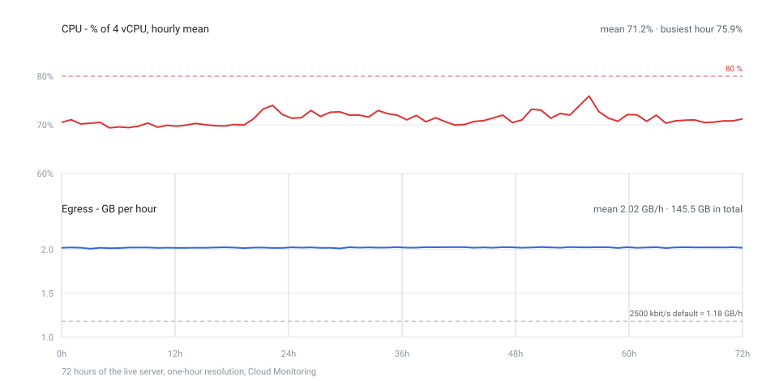

# cs16-shortchaos

[English](README.md) · **Русский**

Сервер **Counter-Strike 1.6**, который транслируется вертикально в YouTube Shorts. Это обычный
сервер, куда можно зайти людям; когда на нём никого нет, пустые слоты добивают боты — чтобы в тихий
час на экране всё равно шёл матч. Каждые несколько минут правила меняются: ножевой раунд,
зомби-раунд, один бот с M249 против всех. А зритель может повлиять на то, что будет дальше.

Состояние: работает end-to-end на живом сервере — ReHLDS + Metamod-R + AMX Mod X, клиент захвата
сам рисует матч на виртуальном дисплее, control API хранит историю. Проверено в игре: событие,
отправленное из API, сработало на сервере (`donation_events ran bot_nick`).

## Как зайти

Сервер слушает `27015`. Compose публикует этот порт только на loopback (`127.0.0.1:27015`): по
умолчанию это одна машина, которая стримит сама себя, — чтобы пускать людей, публикуй `0.0.0.0:27015`
и открой порт в файрволе. Ещё сервер работает в LAN-режиме (у клиента захвата нет Steam-тикета):
из-за этого его нет в списке мастер-серверов, и заходят по IP. Пустые слоты держат боты
(`yb_quota 20` при `MAXPLAYERS=22`) — уменьши квоту, чтобы оставить место людям.

## Что покупает донат

- **50 ₽ — ровно один шаг**: каждые полные 50 ₽ покупают одно событие, вытянутое из каталога
  случайно (150 ₽ — три шага), поэтому деньги не сгорают остатком;
- повтор события **складывается по времени**, а не повторяется: три шага HE-пати дают 180 секунд;
- чужие валюты (USD, EUR, KZT, BYN, UAH) конвертируются в рубли по консервативному курсу и
  округляются вниз; неизвестная валюта отклоняется;
- ник донатера проходит модерацию (ссылки и реклама заменяются на `Anonim_Bot`) и попадает на табло
  как `[DONOR] <ник>`;
- коды событий стабильны: Pawn-плагин регистрирует обработчики по коду.

## Что происходит без донатов

Раз в три минуты — бесплатная ротация (`config/auto-events.json`): 23 кода, полный цикл ~69 минут.
Платные hero-режимы в неё не попадают: свободный геройский раунд оставил бы зрителя без покупки.
Шкала «ХАОС» и отсчёт до следующего бесплатного события на экране всегда, даже в тихую минуту.

## Как это устроено

```
донат → DonationAlerts API (опрос каждые 3 с) → сумма → событие
      → кулдауны → RCON `amx_de <code>` → Pawn-плагин → эффект в игре
```

| Каталог | Что внутри |
| --- | --- |
| `src/` | control API на Node: опрос донатов, маппинг суммы в событие, кулдауны, RCON, SQLite, панель оператора |
| `plugins/` | восемь Pawn-плагинов AMX Mod X: реестр событий, гонка T vs CT, камера стрима, CSDM и антизастревание ботов |
| `infra/` | Docker-образы: сервер (HLDS + ReHLDS + ReGameDLL + Metamod-R + AMX Mod X + YaPB) и захват экрана с энкодером |
| `config/` | каталог активностей (цены, длительности, кулдауны) и бесплатная ротация |

Всё скачано из официальных релизов и закреплено по SHA256 — в образах нет `FROM someone/hlds`.

## Требования

| Что | Минимум | Зачем |
| --- | --- | --- |
| Node.js | **24** | исходники на TypeScript запускаются напрямую, шага сборки нет |
| Docker | Engine 27+ с плагином compose 2.30+ | в compose нужны `cpuset:` и `depends_on: condition:` |
| CPU | x86_64, 4 vCPU | в образах 32-битные бинарники GoldSrc и Xash3D, ARM их эмулирует |
| RAM | 4 ГБ (8 ГБ комфортно) | живой стек — ~1.1 ГБ, сборка образов просит ~2 ГБ |
| Диск | 40 ГБ (60 ГБ комфортно) | два образа ~4 ГБ, тома сервера ~1.5 ГБ и клиента ~2 ГБ |
| Сеть | 5 Мбит/с на отдачу | поток идёт CBR ~4.5 Мбит/с в RTMPS на 443 |
| GPU, дисплей | не нужны | клиент захвата рисуется на своём Xvfb с software OpenGL |

## Быстрый старт

```bash
git clone https://github.com/silentalarm/cs16-shortchaos.git
cd cs16-shortchaos
npm install                              # только dev-зависимости для npm run typecheck
cp .env.example .env && chmod 600 .env   # RCON_PASSWORD и ADMIN_TOKEN; остальное можно оставить пустым

pwsh -File infra/update-checksums.ps1    # адреса и SHA256 всех компонентов в infra/checksums.env
bash infra/build-images.sh               # оба образа, 10-20 минут на 4 vCPU
bash infra/compose.sh dev                # сервер + панель, без ключа стрима
```

`bash infra/compose.sh up -d` (без `dev`) поднимает ещё и контейнер захвата — ему нужен
`YOUTUBE_STREAM_KEY` или `STREAM_OUTPUT`. Путь от пустого VPS до эфира целиком — в
[`docs/deploy.md`](docs/deploy.md).

Проверки без доната, канала и игрового сервера: `npm test`, `npm run ui-preview` и
`RCON_PASSWORD= npm start` (dry run: команды логируются, не отправляются).

## Что показывает мониторинг

Три дня живого сервера (4 vCPU / 8 ГБ, Cloud Monitoring, разрешение один час). Дат на оси нет —
важна форма, а не день.



- **CPU**: 71.2 % от 4 vCPU (~2.85 ядра), самый загруженный час — 75.9 %, ни один замер не выше
  80 %. Запаса меньше ядра: запись в файл или второй клиент захвата в него уже не влезут.
- **Отдача ровная**: 2.02 ГБ в час против 2.03 в самом загруженном, ~4.5 Мбит/с, 48.5 ГБ за полные
  сутки, ~1.45 ТБ в месяц. Расстояние до серого пунктира — это и есть проверка битрейта: 2500 кбит/с
  плюс 128 кбит/с аудио давали бы 1.18 ГБ/ч, значит хост выставляет ~4000.
- **Приём**: 1.8 ГБ в сутки (~0.17 Мбит/с) — на порядок меньше отдачи.
- **Диск**: 31.8 ГБ записи и 2.1 ГБ чтения (~10.6 ГБ в сутки) — логи, лог ffmpeg и WAL SQLite.
- **Итого за 72 часа**: 145.4 ГБ наружу и 5.4 ГБ внутрь, ноль перезапусков (uptime 88.6 ч).

Памяти в цифрах нет намеренно: в Compute Engine нет метрики RAM без Ops Agent, а на этом хосте его
нет.

## Документация

| Файл | О чём |
| --- | --- |
| [`README.md`](README.md) | полное описание по-английски: каталог, ротация, стрим, панель, сборка |
| [`docs/deploy.md`](docs/deploy.md) | от пустого VPS до эфира: размеры машины, `.env`, firewall, OAuth, счёт |
| [`docs/runbook.md`](docs/runbook.md) | операторские заметки: почему сделано именно так, разборы падений |
| [`docs/events.md`](docs/events.md) | события, их параметры и контракт между каталогом и плагином |
| [`docs/activities/`](docs/activities) | каталог активностей, системы, дорожная карта |

## Безопасность

Секреты (пароль RCON, токен панели, ключ стрима, пара DonationAlerts) живут только в `.env`, который
в git не попадает; панель слушает loopback и требует токен в заголовке; ники донатеров проходят
санитайзер, а не подставляются в RCON-команду как есть.
