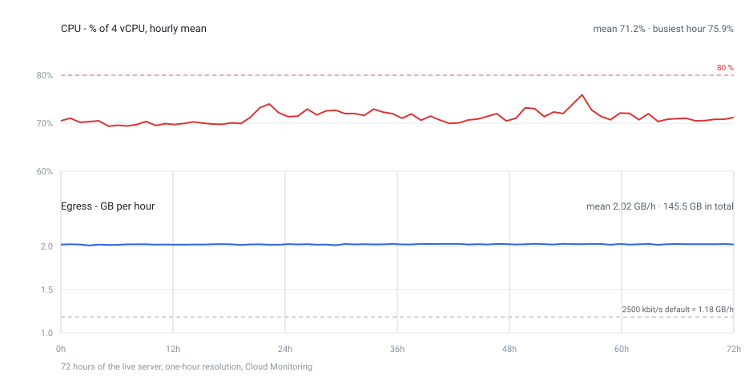

# Deploying on a VPS

The whole stack is three containers and a directory of files: a game server (`cs16-hlds:local`), the
control API that turns a donation into an RCON command (`node:24-bookworm-slim` with this repository
mounted read-only), and the capture container that renders the match on a virtual display and pushes
it to YouTube (`cs16-stream:local`). Nothing needs a GPU, a Steam login or a human at the keyboard.

This page is the operator path from an empty VPS to a live stream, and every command runs from a plain
bash shell. Three steps are PowerShell-only (`update-checksums.ps1` and the two `verify-*.ps1`): call
them through `pwsh -File`, or run them once on a machine that already has PowerShell and copy the
result over.

## Quick path

Everything on this page, without the reasons:

```bash
# on the VM, once Docker is installed and the repository is cloned (sections 2-3)
sudo cp .env.example .env && sudo chmod 600 .env   # RCON_PASSWORD, ADMIN_TOKEN, YOUTUBE_STREAM_KEY
sudo bash infra/deploy.sh                     # ~10-20 min: checks, builds both images, starts the stack
sudo bash infra/deploy.sh --check             # three services, the plugin line, the panel, the encoder
```

`--check` is the health report and can be run at any time, including on a live server; `--no-build`
restarts the containers without rebuilding, which is what a `.env` change or a new map needs. The
sections below are the same path with the reasons and the failure modes.

## 1. The host

| What | Requirement | Why |
| --- | --- | --- |
| CPU | **x86_64**, 4 vCPU | the images ship 32-bit GoldSrc binaries; an ARM VPS would emulate every frame |
| RAM | 8 GB (4 GB works, 8 GB builds comfortably) | the live stack measures ~1.1 GB; the image build needs ~2 GB |
| Disk | 60 GB SSD (40 GB minimum) | two images ~4 GB, the server volume ~1.5 GB, the client volume ~2 GB, logs and rebuilds |
| Network | 5 Mbit up, 100 Mbit down | the upload measured 4.3 Mbit/s CBR on the live host, so 5 Mbit up is a floor, not a comfort |
| OS | Debian 12 or Ubuntu 22.04+ | `debian:bookworm-slim` and `debian:trixie-slim` are the image bases |
| Docker | Engine 27+ with the compose plugin 2.30+ | the compose file uses `cpuset:` and `depends_on: condition:` |

Measured on a desktop, per container: the game server 0.05 core / ~190 MB, the capture client ~1.6
cores (software OpenGL, and no encoder setting changes that), the encoder 0.4-0.7 core, Xvfb and
PulseAudio 0.2 together. So the live stack is ~2.2 cores and ~1.1 GB; the rest of the box is for the
build and for the operating system.

### What the live server used over three days

Measured on the production VM (`e2-custom-4-8192`, 4 vCPU / 8 GB, `europe-west4-a`) from Cloud
Monitoring at one-hour resolution over 72 hours, with the stream running the whole time and the VM
never restarted (uptime 88.6 h at the end of the window). The axis carries hours, not dates: the
shape is the point, the day is not. Figures are decimal (GB = 10^9 bytes, Mbit = 10^6 bit), the same
units the bill below uses.



- **CPU**: 71.2 % of 4 vCPU mean (~2.85 cores). The busiest hour averaged 75.9 % and no sample in the
  window went above 80 %, so the headroom left is under one core - which is why a recording
  (`STREAM_OUTPUT` to a file) or a second capture client does not fit here; the per-container split is
  above.
- **The upload is flat**: 2.02 GB an hour against 2.03 in the busiest one, ~4.5 Mbit/s, 48.5 GB per
  full day, ~1.45 TB a month. The distance to the grey line is the point of the second chart: 2500
  kbit/s of video plus 128 kbit/s of audio would be 1.18 GB/h, so this host runs `STREAM_BITRATE_KBPS`
  at ~4000.
- **Ingress**: 1.8 GB a day (~0.17 Mbit/s), an order of magnitude below the upload.
- **Disk**: 31.8 GB written and 2.1 GB read (~10.6 GB a day) - logs, the ffmpeg log and the SQLite
  WAL. On a 60 GB boot disk that is worth watching, nothing more.
- **Totals**: 145.4 GB out and 5.4 GB in over the three days.
- RAM is absent on purpose: Compute Engine has no memory metric without the Ops Agent, and this host
  does not run it.

The filters behind the numbers, if you want to repeat them: `compute.googleapis.com/instance/cpu/utilization`
(mean and max), `.../instance/network/sent_bytes_count` and `.../received_bytes_count` (rate),
`.../instance/disk/write_bytes_count` and `.../read_bytes_count` (rate), `.../instance/uptime_total`,
all with a 3600 s alignment period.

## 2. Docker

```bash
# Debian/Ubuntu, official repository (the distro package ships an old Engine without buildx)
sudo apt-get update && sudo apt-get install -y ca-certificates curl git
sudo install -m 0755 -d /etc/apt/keyrings
curl -fsSL https://download.docker.com/linux/debian/gpg | sudo tee /etc/apt/keyrings/docker.asc >/dev/null
# Ubuntu: the ubuntu/gpg key above, and "$ID" instead of "debian" in the sources line
echo "deb [arch=amd64 signed-by=/etc/apt/keyrings/docker.asc] https://download.docker.com/linux/debian $(. /etc/os-release && echo "$VERSION_CODENAME") stable" \
  | sudo tee /etc/apt/sources.list.d/docker.list >/dev/null
sudo apt-get update && sudo apt-get install -y docker-ce docker-ce-cli containerd.io docker-buildx-plugin docker-compose-plugin
sudo usermod -aG docker "$USER"   # log out and back in for this to take effect
docker version && docker compose version && docker buildx version
```

## 3. The repository

```bash
git clone https://github.com/silentalarm/cs16-shortchaos.git
cd cs16-shortchaos
```

A fresh clone is complete: the maps (`infra/maps/*.bsp`, `.nav`, `.res`, the `.wad` they need), the
navigation graphs the bots read (`infra/maps/graph/`) and the hero models (`infra/models/`) are
committed. Nothing is downloaded from a map site on the VPS, and there is no fetch step to remember.

One file is **not** in git and the build refuses to start without it: `infra/checksums.env`, the
pinned URLs and SHA256s. Copy it from a machine that has run `infra/update-checksums.ps1`, and keep
it LF-clean - `infra/build-images.sh` strips a stray `\r` for exactly this reason.

## 4. `.env`

```bash
cp .env.example .env
chmod 600 .env
```

Keys that must not be empty, and where they come from:

| Key | Source |
| --- | --- |
| `RCON_PASSWORD` | anything random: `openssl rand -hex 16`. Stays on the host, the port is loopback-only |
| `ADMIN_TOKEN` | anything random: `openssl rand -hex 24`. The panel does not start without it |
| `YOUTUBE_STREAM_KEY` | YouTube Studio -> Create -> Go live -> Stream, the key under the encoder settings |
| `DA_CLIENT_ID`, `DA_CLIENT_SECRET` | the DonationAlerts application of the streamer account |
| `DA_REDIRECT_URI` | must match the application exactly: `http://127.0.0.1:4318/oauth/callback` |
| `DA_MOCK` | `1` runs the whole pipeline on fake donations - the right setting until the account is connected |

`bash infra/deploy.sh` refuses to start while `RCON_PASSWORD` or `ADMIN_TOKEN` is empty, and warns
about an empty stream key or `DA_MOCK=1`. It never prints a value. Both it and `--check` want `sudo`:
the file belongs to uid 1000 with mode 600, because the control API reads `.env` from the read-only
repository mount as that user, and an unprivileged shell cannot read it back.

Real donations need one OAuth round-trip that writes `data/da-token.json`. The script listens on
`127.0.0.1:4318`, so on a headless VPS it runs in a throwaway container with the host network, and
the browser reaches it through an SSH tunnel:

```bash
ssh -L 4318:127.0.0.1:4318 <user>@<host>        # from your own machine, keep it open
docker run --rm -it --network host --user "$(id -u):$(id -g)" --env-file .env \
  -v "$PWD:/app" -w /app node:24-bookworm-slim node scripts/oauth-login.ts
```

Open the printed URL in your local browser, approve, and `data/da-token.json` appears on the VPS.
Running the same script on your own machine and copying the file over is equivalent.

## 5. First start

```bash
sudo bash infra/deploy.sh
```

What it does, in order: checks the host (x86_64, Docker, compose plugin), checks `.env` for the two
keys the stack cannot run without, hands `data/` to uid 1000 (the control API writes its SQLite
history there as an unprivileged user, and a root-owned directory fails every write with `EACCES`),
builds both images from the pinned checksums, then brings the stack up with `--force-recreate`.

The first build is the slow one (10-20 minutes on 4 vCPU): it downloads HLDS app 90 through SteamCMD
(anonymous, pinned legacy manifest), ReHLDS, ReGameDLL, Metamod-R, AMX Mod X, YaPB, Xash3D and
CS16Client, each verified against `infra/checksums.env`, and renders the event music and sounds.

After a `git pull`, the same command is the whole deploy: rebuild, recreate, done. A plain
`docker restart` keeps the old image and is never the right answer.

## 6. Verify

```bash
sudo bash infra/deploy.sh --check
```

Expected, in order: three services `running`; `hlds: donation_events loaded`; `panel: 200 on
/api/state`; `stream: running` with encoder progress lines. Then, from your machine:

```bash
ssh -L 8080:127.0.0.1:8080 <user>@<host>       # then open http://127.0.0.1:8080/
```

The panel shows the catalogue, the last donations and the live picture. Two deeper checks, both of
which need the stack up:

```bash
# every activity in the plugin, i.e. the catalogue and the .amxx agree
bash infra/compose.sh exec -T control-api node -e \
  "import('./src/rcon.ts').then(async m => console.log(await m.execOnce({host:'hlds',port:27015,password:process.env.RCON_PASSWORD},'amx_de codes')))"

# the smoke test: one activity on every map of the rotation, ~5 minutes; a real donation never does this
bash infra/compose.sh exec -T control-api node scripts/map-walk.ts
```

## 7. Going live on YouTube

1. YouTube Studio -> Create -> Go live -> Stream. Copy the stream key into `YOUTUBE_STREAM_KEY`.
2. Recreate the capture container so it reads the key: `bash infra/compose.sh up -d --force-recreate stream`.
3. Watch it: `bash infra/compose.sh logs -f stream`. `frame=` lines mean the encoder is sending
   (`STREAM_FFMPEG_LOGLEVEL=info`); `speed` below 1.0 means it cannot keep up, and a growing `dup`
   counter means the client renders slower than the capture rate.
4. YouTube shows "Preparing stream" for a few seconds: it waits for the first keyframe.

`STREAM_BITRATE_KBPS` is 3000 by default - the floor for 720x1280@30 with Counter-Strike movement.
2000 falls apart in a firefight, and the VPS uplink has to carry it.

## 8. Ports and the firewall

```bash
sudo ufw default deny incoming
sudo ufw allow 22/tcp        # SSH, and nothing else
sudo ufw enable
```

That is the whole firewall: the game port (27015) and the panel (8080) are published to `127.0.0.1`
on purpose, because RCON rides the game port and the panel can send RCON commands. The capture
container pushes out to YouTube on 443; nothing has to come in. To play from your desktop, use a
tunnel rather than a published port:

```bash
ssh -L 27015:127.0.0.1:27015 <user>@<host>     # then connect to 127.0.0.1:27015 in the game
```

If SSH itself does not get through - some networks reset the connection right after the TCP
handshake, on :22 and on any other port, while sshd on the host is perfectly healthy - tunnel it over
HTTPS with IAP instead of fighting the path: enable `iap.googleapis.com`, allow `35.235.240.0/20` to
tcp:22 for the instance tag, then

```bash
gcloud compute start-iap-tunnel cs16 22 --local-host-port=127.0.0.1:2222 --zone=<zone>
ssh -p 2222 <user>@127.0.0.1        # in a second window, the tunnel stays in the foreground
```

The same mechanism exposes the panel with no inbound rule at all:
`gcloud compute start-iap-tunnel cs16 8080 --local-host-port=127.0.0.1:8080 --zone=<zone>`.

## 9. Day two

| Task | Command |
| --- | --- |
| deploy a code change | `git pull && bash infra/deploy.sh` |
| restart only (`.env`, a new map, a crash) | `bash infra/deploy.sh --no-build` |
| game server log | `bash infra/compose.sh logs -f hlds` |
| capture log | `bash infra/compose.sh logs -f stream` |
| stop paying for the picture, keep the panel | `bash infra/compose.sh dev up` |
| free space after a few rebuilds | `docker image prune -f && docker builder prune -f` |

**Backups.** Four things are not in git and not reproducible: `data/control.db` (donation history,
admin actions), `data/da-token.json` (the OAuth tokens), `data/activities.override.json` (panel
tweaks) and `.env`. A nightly copy is enough:

```bash
0 4 * * * cd /srv/cs1.6-youtube && tar czf /srv/backups/cs16-$(date +\%F).tgz \
  data/control.db data/da-token.json data/activities.override.json .env
```

SQLite is written while the API runs, so a copy of a live `control.db` can be torn; the donation
history is not worth a `.backup` dance, but if it ever is, use `sqlite3 data/control.db ".backup ..."`.

## 10. Troubleshooting

| Symptom | Cause | Fix |
| --- | --- | --- |
| `error while interpolating ... RCON_PASSWORD` | `.env` missing or the key is empty | `cp .env.example .env`, fill it in, `--no-build` |
| the panel answers but every list is empty | `data/` is not writable by uid 1000 | `sudo chown -R 1000:1000 data`, then `--no-build` |
| `panel: /api/state did not answer` | the API crashed on start | `bash infra/compose.sh logs control-api`, look for `ADMIN_TOKEN` |
| `up` fails with a cpuset error | `STREAM_CPUSET`/`HLDS_CPUSET` name cores this host does not have | leave both empty |
| YouTube says "Preparing stream" for ever | the encoder is not sending | `STREAM_FFMPEG_LOGLEVEL=info`, read `speed=` in the log |
| `Cannot read RTMP handshake response` | plain RTMP on 1935, dropped by the ISP | keep RTMPS on 443 (`RTMP_INGEST_URL`) |
| bots do not join | `yb_quota` below 20, or `MAXPLAYERS` below 22 | the camera is a real connection: it needs its own slot |
| the picture freezes every few rounds | the client fell off the server | the watchdog restarts it: `grep watchdog` in the stream log |

## 11. The scripts and their bash twins

| PowerShell | bash |
| --- | --- |
| `pwsh -File infra/build-image.ps1` | `bash infra/build-images.sh hlds` |
| `pwsh -File infra/build-stream.ps1` | `bash infra/build-images.sh stream` |
| `pwsh -File infra/compose.ps1 <args>` | `bash infra/compose.sh <args>` |
| `pwsh -File infra/verify-image.ps1`, `verify-stream.ps1` | no twin - `pwsh -File`, or the section 6 checks |
| `pwsh -File infra/update-checksums.ps1` | no twin - run it once, then copy `infra/checksums.env` to the host: it is **gitignored**, so a clone does not carry it |

One rough edge that is already handled: `.dockerignore` keeps the build context at ~14 MB (it was
~198 MB with `out/`, `node_modules/` and `.tmp-*`). The file is short on purpose - a pattern there
that matches a `COPY` source breaks the build with a "not found" that names no cause, so nothing
under `src/`, `plugins/`, `infra/` or `config/` is filtered. Anything new that a Dockerfile needs
must stay out of it.

## 12. Appendix: Google Cloud

The video upload - not the CPU - is what costs: it measured 4.5 Mbit/s of RTMPS, ~1.45 TB a month
(section 1, "What the live server used over three days"), and GCP charges that as internet egress.

**Machine.** `e2-custom-4-8192` (4 vCPU / 8 GB): custom, because 8 GB is the measured need and the
predefined `e2-standard-4` (4 vCPU / 16 GB) costs ~25% more for memory nothing uses.

```bash
# One call: the tag goes on at creation, so the firewall rule has something to attach to and no
# second `add-tags` call is needed.
gcloud compute instances create cs16 \
  --zone=europe-west4-a \
  --machine-type=e2-custom-4-8192 \
  --image-family=ubuntu-2404-lts-amd64 \
  --image-project=ubuntu-os-cloud \
  --boot-disk-size=60GB \
  --boot-disk-type=pd-balanced \
  --network-tier=STANDARD \
  --tags=cs16

# SSH only, from one address: the game port and the panel stay loopback (section 8), so no other rule
# is needed. Explicit direction/action/priority so the rule reads the same as the console shows it.
gcloud compute firewall-rules create cs16-ssh \
  --direction=INGRESS \
  --priority=1000 \
  --network=default \
  --action=ALLOW \
  --rules=tcp:22 \
  --source-ranges="$(curl -s https://ifconfig.me)/32" \
  --target-tags=cs16
```

The default VPC also ships `default-allow-ssh`, which allows port 22 from every address at priority
65534. The rule above is priority 1000 and therefore wins for the tagged instance, but the fallback
is still there for any untagged VM in the project: delete it if the project is dedicated
(`gcloud compute firewall-rules delete default-allow-ssh`), or leave it and treat `--source-ranges`
as the real gate.

Two flags worth knowing about the create call: `--network-tier=STANDARD` is set on the instance's
NIC and is the one that changes the egress price (section below), and the ephemeral external IP it
still gets is enough for RTMPS out and for SSH in - nothing has to be reserved.

**The bill**, europe-west4, on demand:

| Item | Per month |
| --- | --- |
| VM `e2-custom-4-8192` | ~$0.12/h, ~$87 |
| 60 GB `pd-balanced` boot disk | ~$6 |
| ~0.95 TB egress, Premium tier (default) | ~$117 ($0.12/GB, 1 GiB free) |
| ~0.95 TB egress, Standard tier | ~$64 ($0.085/GB after 200 GiB free) |
| **Total** | **~$157 on Standard, ~$210 on Premium** |

Those egress rows are sized for 3 Mbit/s. At the 48.5 GB a day measured in section 1 (~1.45 TB a
month) the egress line becomes ~$105 on Standard (~$198 in total) and ~$175 on Premium (~$268). The
bitrate is the knob: this host runs at ~4000 kbit/s against the 2500 `STREAM_BITRATE_KBPS` default,
and going back to 2500 at 720p30 removes ~40 % of those two figures.

A budget alert on day one is the cheap insurance: `Billing -> Budgets & alerts`. Between broadcasts
`bash infra/compose.sh dev` stops exactly the capture container and keeps the game server and the
panel, which is the mode the stack spends most of its life in.

**Choices that matter.** `--network-tier=STANDARD` cuts the egress bill by ~45% and RTMPS does not
notice the difference; ARM machine types (`T2A`, `C4A`) cannot run these images; the always-free
`e2-micro` is a 1 GB shared-core box, which is not this stack.

**Honest comparison.** For a 24/7 stream a VPS whose price includes traffic (Hetzner, Contabo,
Timeweb, Selectel - single-digit euros a month with 20 TB or more) is the cheaper home; the hourly
`e2-custom` box is the right machine to build and test this stack on.


